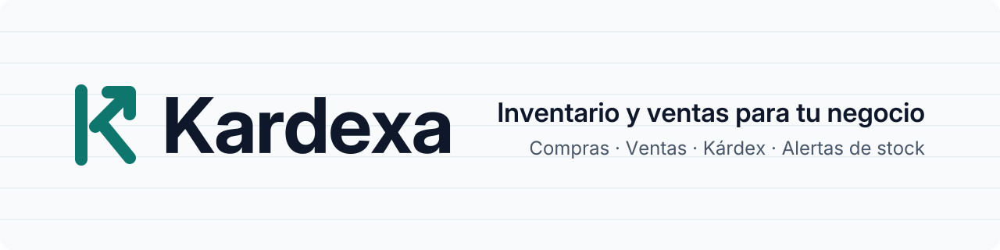

<picture>
  <source media="(prefers-color-scheme: dark)" srcset="assets/branding/banner-oscuro.svg">
  
</picture>

<p align="center">
  <a href="LICENSE"></a>
  
  
  
  
  
</p>

**Kardexa** es un sistema de inventario y ventas para pequeños negocios: bodegas, ferreterías y minimarkets. El nombre viene del *kárdex*, la tarjeta de control de inventario muy usada en Perú.

## El problema

Muchos negocios pequeños controlan su stock en un cuaderno o en Excel. No saben qué productos se van a acabar, cuáles se venden más ni cuánto ganan, y las compras y ventas no quedan registradas de forma confiable.

## La propuesta

- **Kárdex por producto:** cada entrada y salida queda registrada con su saldo.
- **Alertas de stock mínimo** antes de que el producto se agote.
- **Compras que suman stock y ventas que lo descuentan**, con comprobante interno.
- **Panel con indicadores:** ventas por día, productos más vendidos y stock crítico.

Este repositorio también documenta **el proceso**: requisitos, diagramas, decisiones de arquitectura (ADR) y una bitácora semanal.

## Stack previsto

| Capa | Tecnología |
|---|---|
| Backend | Java 21 · Spring Boot 3 · arquitectura hexagonal · Spring Security con JWT propio |
| Base de datos | PostgreSQL · Flyway |
| Frontend (panel) | React · TypeScript · Vite |
| Documentación de API | OpenAPI / Swagger |
| Landing | Astro |
| Entorno local | Docker Compose (PostgreSQL) |
| CI | GitHub Actions |

> El stack se confirma con un ADR en la fase 1. Sin servicios externos de autenticación: todas las APIs son propias.

## Plan por fases

| Fase | Contenido | Estado |
|---|---|---|
| 0 · Problemática | Problema, actores, alcance, requisitos e historias de usuario | 🟡 En curso |
| 1 · Diseño | C4, modelo ER, flujos, contrato OpenAPI, ADRs | ⚪ Pendiente |
| 2 · Base técnica | Monorepo, Docker Compose, esqueletos, CI | ⚪ Pendiente |
| 3 · Autenticación | Registro, login, roles, JWT | ⚪ Pendiente |
| 4 · Catálogo e inventario | Productos, categorías, movimientos, stock mínimo | ⚪ Pendiente |
| 5 · Proveedores y compras | Una compra suma stock | ⚪ Pendiente |
| 6 · Ventas | Una venta descuenta stock | ⚪ Pendiente |
| 7 · Panel y reportes | Dashboard con indicadores | ⚪ Pendiente |
| 8 · Landing | Página pública del producto | ⚪ Pendiente |
| 9 · Despliegue | Publicación gratuita | ⚪ Pendiente |

El avance se sigue en los [milestones](https://github.com/Alfrog7/Kardexa/milestones) y en los [issues](https://github.com/Alfrog7/Kardexa/issues).

## Estructura del repositorio

```text
Kardexa/
├── assets/branding/   # logo, isotipo y banner (SVG)
├── docs/              # problemática, requisitos, arquitectura, ADRs y bitácora
├── backend/           # API Spring Boot (fase 2)
├── frontend/          # panel React (fase 2)
├── landing/           # página pública (fase 8)
├── CHANGELOG.md
└── CONTRIBUTING.md
```

## Documentación

**Fase 0 · Problemática**

- [01 · Problemática](docs/01-problematica.md): contexto, problema, actores, objetivos y alcance del MVP.
- [02 · Requisitos](docs/02-requisitos.md): funcionales, no funcionales, reglas de negocio y trazabilidad.
- [03 · Historias de usuario](docs/03-historias-de-usuario.md): 18 historias con criterios de aceptación.
- [Bitácora](docs/bitacora/README.md): qué hice, qué aprendí y qué decidí cada semana.

**Proyecto**

- [Guía de contribución](CONTRIBUTING.md): flujo de trabajo, ramas, commits y etiquetas.
- [Identidad visual](docs/marca.md): logo, paleta y tipografía.
- [Changelog](CHANGELOG.md)

## Autor

**Alfredo Guzmán** · [@Alfrog7](https://github.com/Alfrog7)

## Licencia

[MIT](LICENSE) © 2026 Alfredo Guzmán
