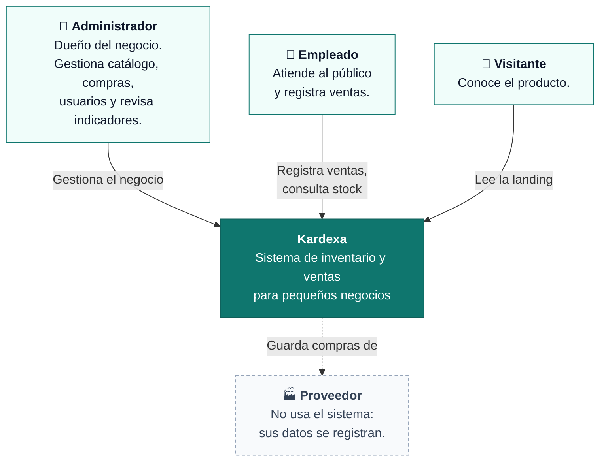
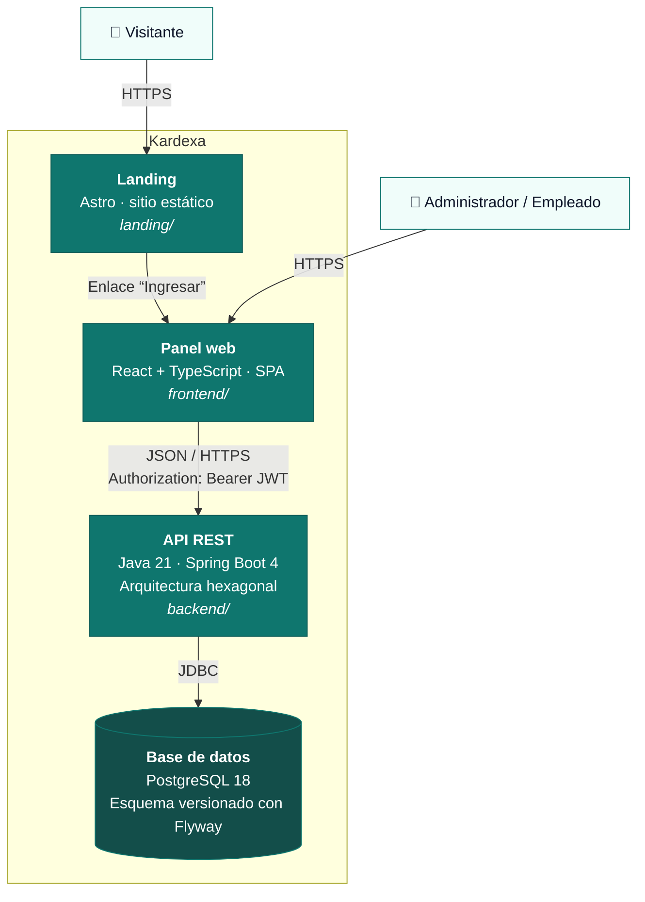
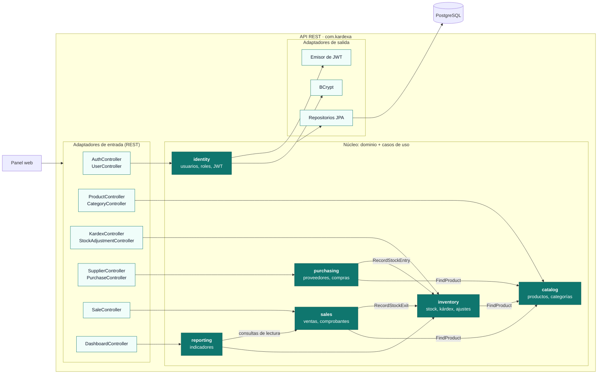

# Modelo C4

Tres niveles de zoom: contexto (el sistema y su entorno), contenedores (piezas desplegables) y componentes (dentro del backend).

## Nivel 1 · Contexto

No hay sistemas externos de autenticación, pagos ni facturación (restricciones de la fase 0).

## Nivel 2 · Contenedores

| Contenedor | Responsabilidad | Despliegue previsto (fase 9) |
|---|---|---|
| Landing | Presentar el producto | Cloudflare Pages / Vercel |
| Panel web | Interfaz de operación diaria | Cloudflare Pages / Vercel |
| API REST | Reglas de negocio, autenticación, persistencia | Render / Koyeb |
| Base de datos | Datos del negocio | Neon (PostgreSQL) |

## Nivel 3 · Componentes de la API

Cada módulo sigue la misma estructura hexagonal ([ADR 0002](../adr/0002-arquitectura-hexagonal.md)). Las flechas entre módulos pasan siempre por **puertos de entrada**.

### Por qué `inventory` es el único que toca el stock

Compras, ventas y ajustes **no modifican el stock directamente**: piden a `inventory` que registre una entrada o una salida. Así, RN-01 (stock no negativo), RN-02 (cálculo del saldo) y el control de concurrencia ([ADR 0006](../adr/0006-concurrencia-del-stock.md)) viven en un solo lugar.
