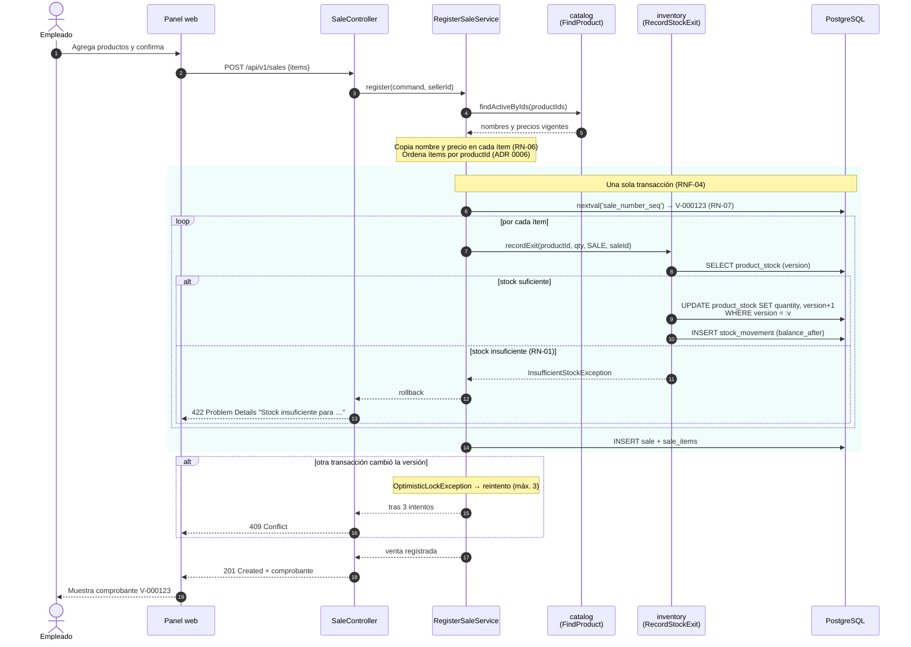
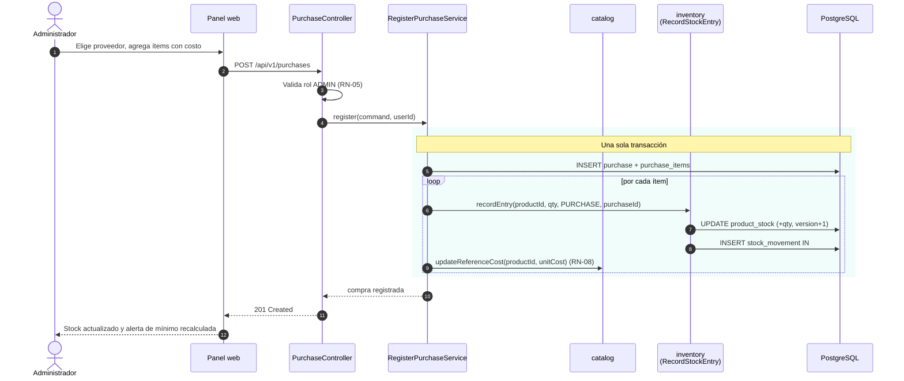
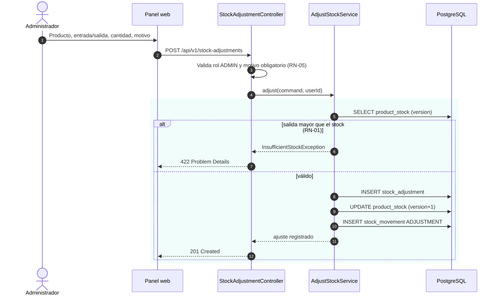

# Flujos principales

## Registrar una venta (HU-14)

## Registrar una compra (HU-12)

## Registrar un ajuste de stock (HU-09)

## Anular una venta (HU-15)

La anulación **no borra nada** (RN-03): marca la venta como `VOIDED` y genera, por cada ítem, un movimiento `SALE_VOID` de entrada que devuelve el stock. El número de comprobante se conserva (RN-07).
