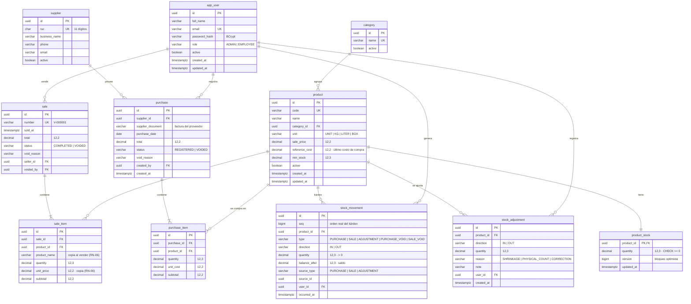

# Modelo entidad-relación

Nombres en inglés y `snake_case` ([ADR 0003](../adr/0003-criterio-de-nombres.md)). Identificadores `uuid`; montos `numeric(12,2)`; cantidades `numeric(12,3)` (RN-12).

## Restricciones e índices

| Tabla | Restricción / índice | Regla |
|---|---|---|
| `product_stock` | `CHECK (quantity >= 0)` | RN-01 |
| `stock_movement` | `CHECK (quantity > 0)`; índice `(product_id, occurred_at)` | RN-02, RF-12 |
| `stock_movement`, `stock_adjustment` | Un *trigger* rechaza `UPDATE` y `DELETE` | RN-03 |
| `product` | `UNIQUE (code)`; índice `lower(name)` para búsqueda | RN-10, RF-08 |
| `supplier` | `UNIQUE (ruc)`; `CHECK (ruc ~ '^[0-9]{11}$')` | RN-10 |
| `sale` | `number` tomado de la tabla `sale_number_counter` dentro de la transacción (ADR 0010); `UNIQUE (number)` | RN-07 |
| `app_user` | `UNIQUE (lower(email))` | RF-03 |

## Por qué existe `product_stock` separado de `product`

El stock cambia en cada venta; los datos del producto, casi nunca. Separarlos permite que el **bloqueo optimista** ([ADR 0006](../adr/0006-concurrencia-del-stock.md)) afecte solo al stock: editar el precio de un producto no hace fallar una venta concurrente.

## Por qué `stock_movement` usa `source_type` + `source_id`

Un movimiento puede venir de una compra, una venta o un ajuste. Una referencia polimórfica evita tres columnas FK casi siempre nulas y permite enlazar el kárdex con su documento de origen (RN-04). La integridad la garantiza el módulo `inventory`, que es el único que escribe en esta tabla.
